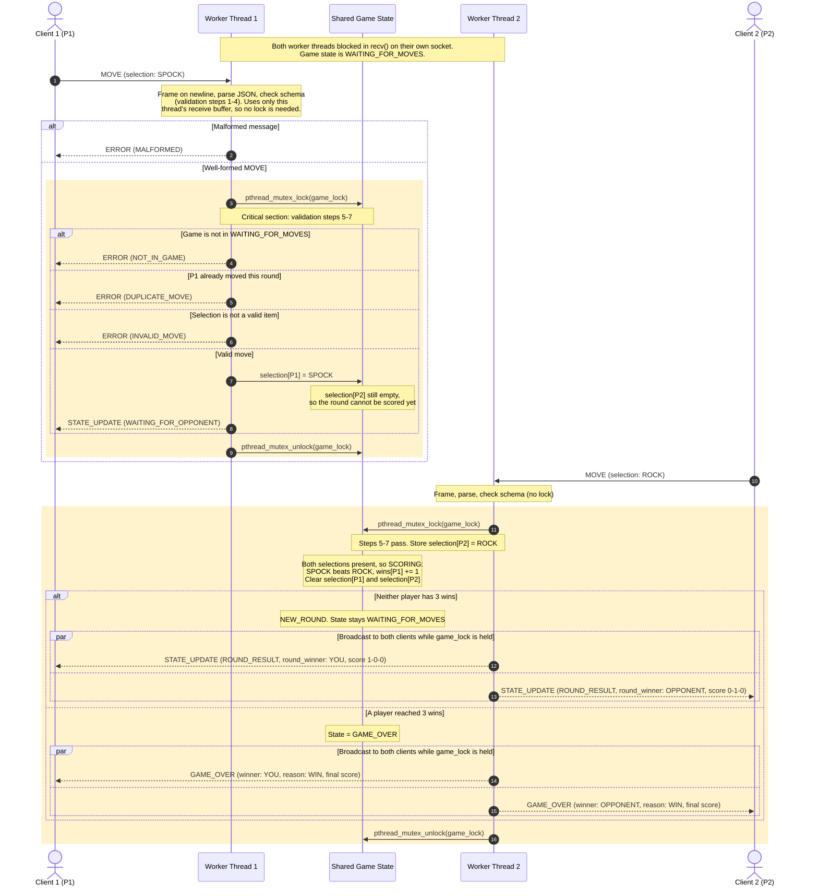

# Move, Score & State Broadcast Sequence

One round of play on the multi-threaded server. Each client has its own detached worker thread (`pthread_create`) blocked in `recv()` on that client's socket. All shared game state is guarded by a single `pthread_mutex_t game_lock`.

Scores are shown as wins-losses-draws from the recipient's point of view.

## Narrative

1. **Move request.** Player 1 sends `MOVE`. Worker Thread 1 frames and parses it using only its own receive buffer, so validation steps 1-4 run without the lock. A malformed message gets `ERROR MALFORMED` and the game state is unchanged.
2. **Server authority validation.** Thread 1 takes `game_lock` before reading any shared state. Under the lock it checks the game phase (`NOT_IN_GAME`), whether P1 already moved this round (`DUPLICATE_MOVE`), and whether the selection is legal (`INVALID_MOVE`). Any failure sends `ERROR` to P1 only and leaves the state untouched.
3. **Out-of-turn protection.** RPSLS has simultaneous moves rather than alternating turns, so a player's "turn" is the single move they get each round. A second `MOVE` before the round resolves is rejected with `DUPLICATE_MOVE`, and a `MOVE` outside `WAITING_FOR_MOVES` is rejected with `NOT_IN_GAME`.
4. **State mutation.** A valid move is stored in `selection[P1]`. P2 has not moved, so P1 gets `STATE_UPDATE WAITING_FOR_OPPONENT` and Thread 1 releases the lock.
5. **Round completion.** When P2's move arrives, Thread 2 takes the lock, validates, and stores `selection[P2]`. The check that both selections are present happens in the same critical section as the store. That prevents both threads from each seeing the other as "not yet moved", which would leave the round unscored, or scoring it twice.
6. **Scoring.** Still holding the lock, Thread 2 decides the round, updates `wins[]` / `draws`, and clears both selections for the next round.
7. **Synchronous broadcast.** Thread 2 sends a personalized `STATE_UPDATE ROUND_RESULT`, or `GAME_OVER` if someone reached 3 wins, to **both** client sockets before releasing the lock. Because no other thread can change the state until both sends finish, both clients receive the same round result and score, and neither can see a newer state first.
